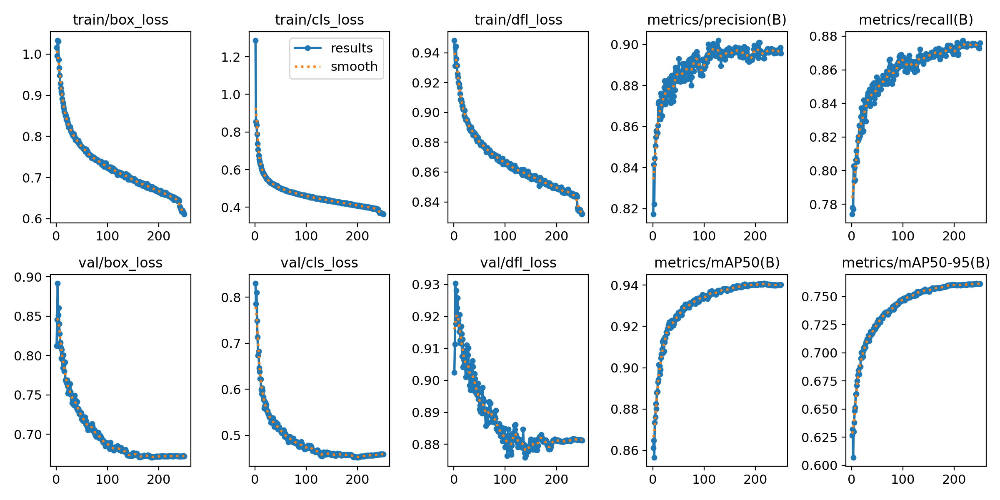
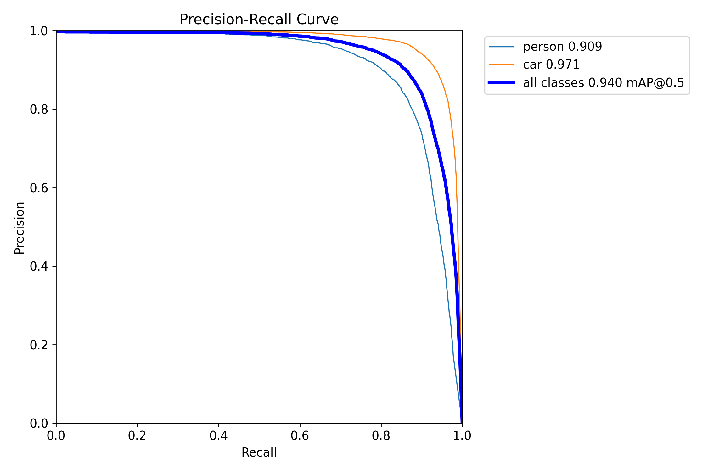
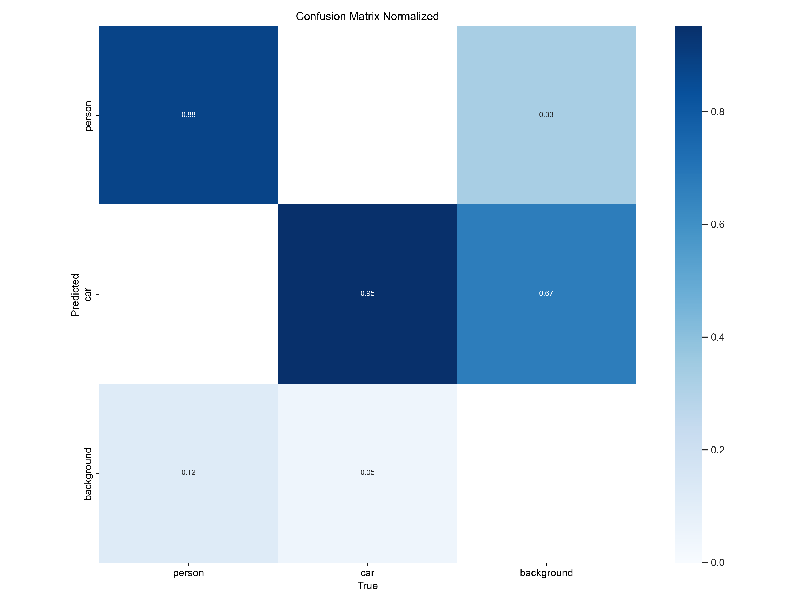
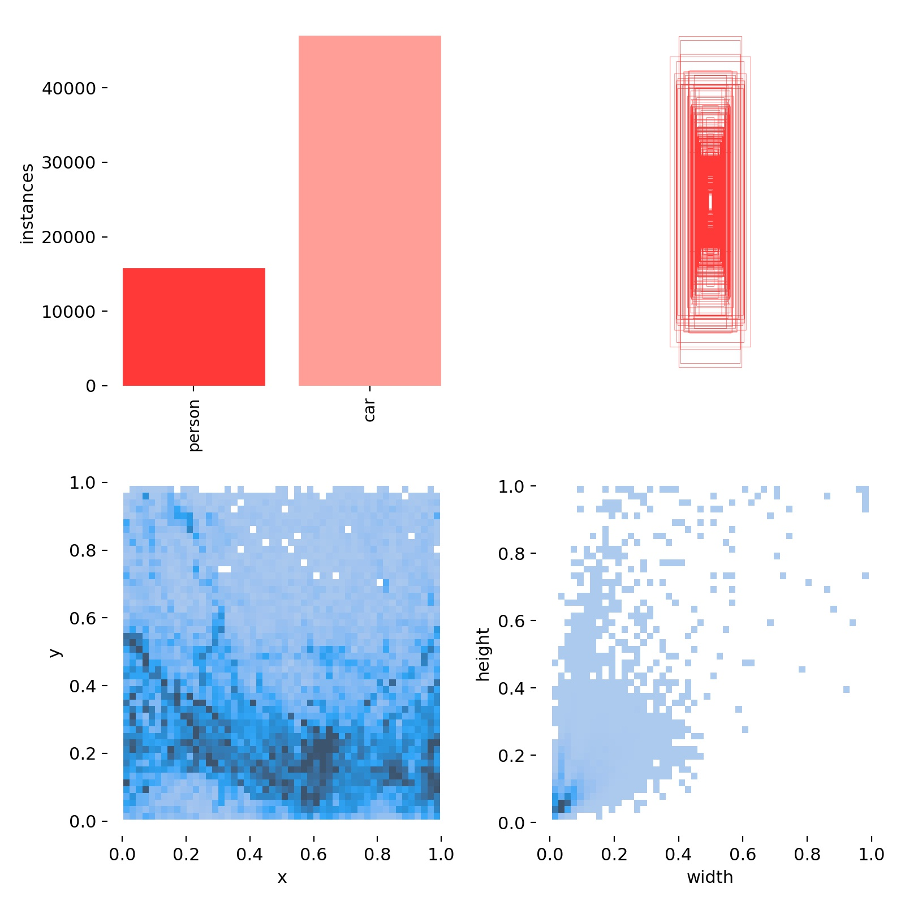
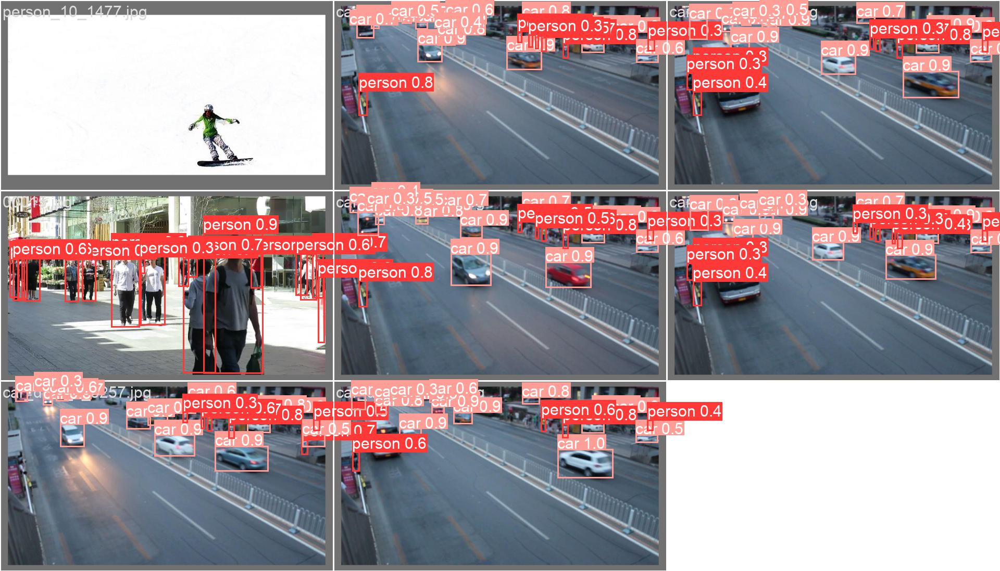
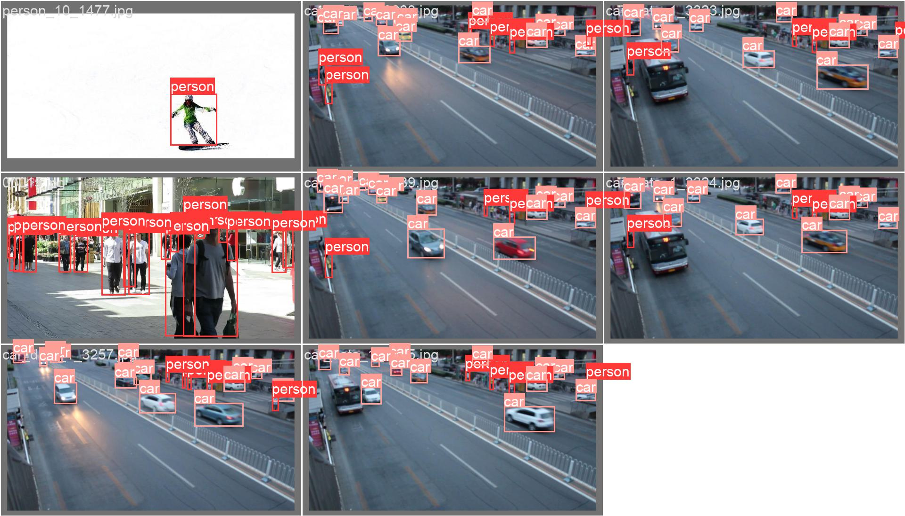

# Car & Person Detection (CarPersonDetection)

A car / person object detection system built on [Ultralytics YOLOv8](https://github.com/ultralytics/ultralytics) and **PyQt5**, featuring a graphical interface for **image, video, webcam, and batch-folder detection**, with exportable results.

> 中文版请见：[README.md](README.md)

## Features

- **Image detection** — open a single image and show bounding boxes, class, confidence, and object counts in real time
- **Video detection** — run frame-by-frame detection on local videos
- **Webcam detection** — real-time detection using your computer's camera
- **Batch detection** — detect all images in a folder and aggregate results into a table
- **Results table** — shows index, file path, class, confidence, and bounding-box coordinates
- **Result export** — save results as image (jpg) or video (avi)
- Detects **person / car** classes, with adjustable confidence and IoU thresholds

## Personal Contributions

Built independently by the author. Key contributions include:

- **Detection system design & implementation** — a PyQt5 GUI supporting four detection modes: image / video / webcam / batch folder (`MainProgram.py`)
- **Inference pipeline** — wrapped YOLOv8 inference, result parsing, bounding-box drawing, Chinese label rendering, and result saving into a full pipeline (`detect_tools.py`)
- **Result visualization** — a results table (index, path, class, confidence, coordinates), object counting, and per-object filtering
- **Model training & tuning** — fine-tuned YOLOv8n on a two-class (person / car) dataset (250 epochs), reaching 94.0% mAP50 (`train.py`)
- **Training analysis tooling** — a custom analysis script `analysis/visual.py` that generates loss / metric curves, a correlation heatmap, and a report
- **Engineering fixes** — diagnosed and fixed a Windows DLL loading-order conflict between PyQt5 and torch (`c10.dll` initialization failure)

## Demo

<div align="center">
  
  
</div>

## Quick Start

### Requirements

- Python 3.8+
- Install dependencies (a virtual environment is recommended):

```bash
pip install -r requirements.txt
```

> Note: `ultralytics` installs `torch` / `torchvision` automatically. For GPU acceleration, install a CUDA-compatible `torch` from the [PyTorch website](https://pytorch.org/).

### Launch the GUI

```bash
python MainProgram.py
```

### Command-line detection (no GUI)

```bash
python imgTest.py      # image detection
python VideoTest.py    # video detection
python CameraTest.py   # webcam detection
```

## Usage

1. Click the **Image** button to pick a single image, or **Folder** for batch detection;
2. Choose **Video** or **Webcam** for real-time detection;
3. View each object's class, confidence, and coordinates in the table on the right;
4. Click **Save** to export results to the `save_data/` directory.

## Model Training

The model is fine-tuned from YOLOv8n pretrained weights; the training script is `train.py`:

```bash
python train.py
```

Training configuration (`train.py`):

| Setting | Value |
| --- | --- |
| Pretrained model | `yolov8n.pt` |
| Dataset | `datasets/CarPersonData/data.yaml` (prepare it yourself) |
| Epochs | 250 |
| Batch size | 4 |

After training, replace `models/best.pt` with the new weights.

## Data & Evaluation

### Dataset

- Classes: `person`, `car`
- Annotation format: YOLO format
- Label distribution (class counts, box sizes, positions) is shown in `labels.jpg` below

### Training Configuration

Fine-tuned from YOLOv8n pretrained weights:

| Setting | Value |
| --- | --- |
| Base model | YOLOv8n |
| Input size | 640×640 |
| Epochs | 250 |
| Batch size | 4 |
| Optimizer | auto (SGD) |

### Evaluation Metrics (validation set)

| Metric | Initial | Final |
| --- | --- | --- |
| Precision | 81.7% | **89.6%** |
| Recall | 77.4% | **87.6%** |
| mAP50 | 86.1% | **94.0%** |
| mAP50-95 | 62.6% | **76.1%** |

> Best mAP50 was reached at epoch 217 (94.08%); mAP50-95 improved by 21.6% from the initial value.

### Evaluation Visualizations

<div align="center">
  
  
</div>

<div align="center">
  
  
</div>

## Run Validation

The model has been validated on both the **validation set** and **real-world scenes**:

- **Validation set predictions** — predictions on held-out data (predicted vs. ground-truth labels below)
- **Real-world detection** — see the **Demo** section above for results on real images

<div align="center">
  
  
</div>

To reproduce: install dependencies per **Quick Start**, then run `python MainProgram.py` or `python imgTest.py`.

## Project Structure

```
CarPersonDetection/
├── MainProgram.py        # Main program (PyQt5 GUI)
├── Config.py             # Configuration (model path, class names, save path)
├── detect_tools.py       # Detection utilities (drawing, Chinese text, coordinate conversion)
├── train.py              # Model training script
├── imgTest.py            # Image detection script (no GUI)
├── VideoTest.py          # Video detection script (no GUI)
├── CameraTest.py         # Webcam detection script (no GUI)
├── installPackages.py    # Dependency installation helper
├── models/
│   └── best.pt           # Fine-tuned car / person detection model
├── yolov8n.pt            # YOLOv8n pretrained weights (for training)
├── analysis/             # Training result analysis
│   ├── visual.py         # Custom analysis script (curves & report)
│   └── results.csv       # Per-epoch training metrics
├── UIProgram/            # UI resources (.ui / .qss / icons, etc.)
├── Font/                 # Chinese font
├── TestFiles/            # Sample images
├── assets/               # README demo & evaluation images
├── requirements.txt      # Dependency list
└── LICENSE               # License (AGPL-3.0)
```

## FAQ

- **`c10.dll` error on Windows startup**: caused by a DLL loading-order conflict between PyQt5 and torch; already fixed in `MainProgram.py` by importing `ultralytics` before `PyQt5`.
- **No objects detected**: adjust `conf` (confidence threshold, default 0.25) and `iou` (IoU threshold, default 0.7) in `MainProgram.py`.

## License

Built on [Ultralytics YOLOv8](https://github.com/ultralytics/ultralytics) (AGPL-3.0). This project is released under the **[AGPL-3.0](LICENSE)** license.

## Acknowledgments

- [Ultralytics YOLOv8](https://github.com/ultralytics/ultralytics) — detection framework and pretrained models
